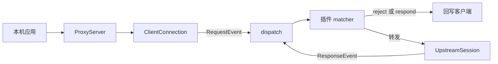

# 架构

ClearClassnet 是一个本机正向代理。应用程序把代理设为 `127.0.0.1:8899` 后，流量进入 `ProxyServer`，由 `ClientConnection` 用 h11 解析 HTTP/1.1。

核心不包含黑名单、课表或页面文案。插件通过公开模块使用事件：

- `clearclassnet.event`：`RequestEvent`、`ResponseEvent`、`ConnectEvent`。
- `clearclassnet.dispatch`：`Rule`，以及 `on_request`、`on_response`、`on_connect`。
- `clearclassnet.response`：`HTMLResponse` 等合成响应。
- `clearclassnet.config.plugin_config`：读取本插件的配置表。

事件上的操作：

- `RequestEvent`：`allow`、`reject`、`rewrite`、`respond`，以及 `bytes` / `text` / `json`。
- `ResponseEvent`：`allow`、`rewrite`。请求和响应共享 `flow.meta`。
- `ConnectEvent`：`intercept`、`tunnel`、`reject`。没有插件做决定时，核心默认 `intercept`。

`tls` 只负责生成 CA 和按 SNI 签发叶子证书。哪些主机需要解密由插件决定，随附的 `mitm_policy` 提供 include/exclude。`tunnel()` 表示不解密，字节原样转发。

正文不超过 `body_limit` 时放在内存里，插件可以读取和替换。超出后写入临时文件，只用于转发。

同一条客户端连接上的交换串行处理，因此一条连接里的事件顺序是确定的。证书缓存用线程锁，因为 OpenSSL 的 SNI 回调不能等待 asyncio 锁。
